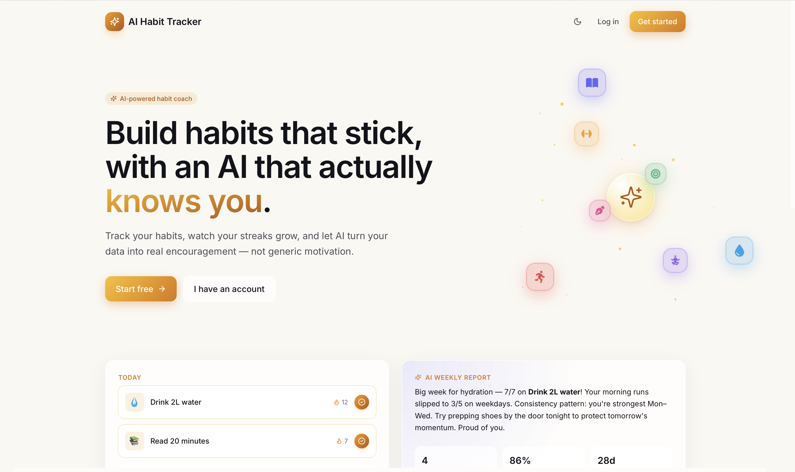
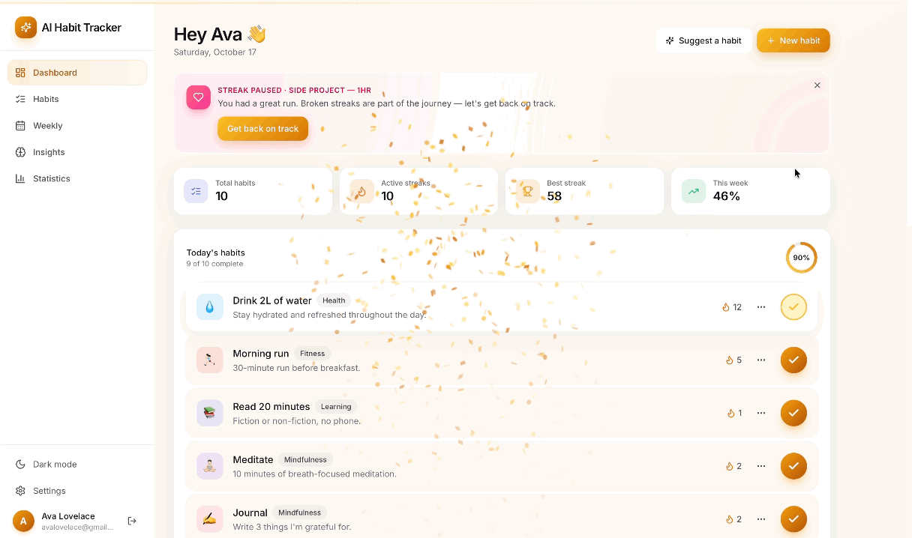
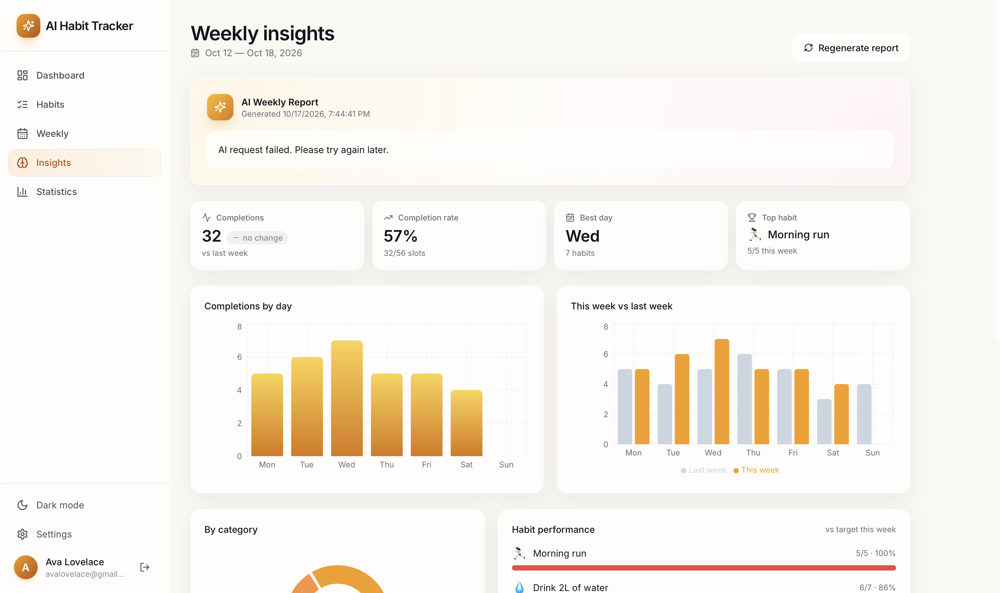
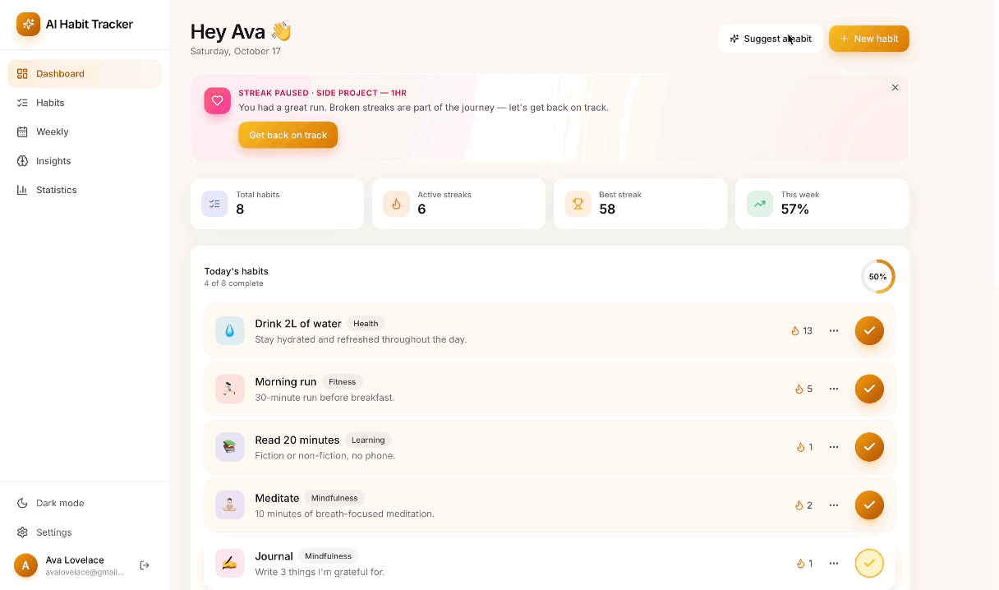
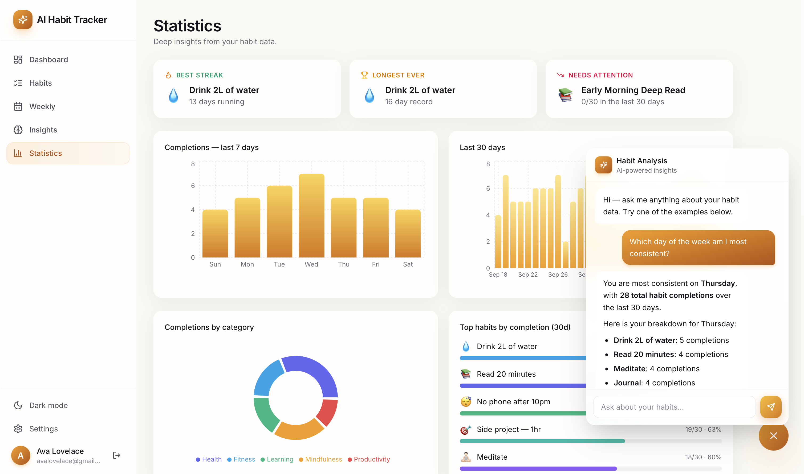

# AI Habit Tracker — Build Habits That Stick, With a Gemini-Powered Coach

> A full-stack habit tracker with streaks, a 90-day heatmap, weekly insights, and five Google Gemini AI features, for anyone who wants their habit data to coach them back.




## Overview

AI Habit Tracker is a MERN-stack app where users check off daily habits, build streaks, and explore their consistency through a GitHub-style heatmap and theme-aware analytics. Five Gemini-powered features turn that data into personalized reports, suggestions, recovery plans, answers, and daily motivation. It includes JWT authentication, light and dark themes, and a seed script that builds a fully populated demo account.

**My contribution:** Built the full backend by following the tutorial (REST API, four Mongoose models, JWT auth, streak logic, Gemini integration) and connected it to the tutorial's frontend boilerplate. Beyond the tutorial, I debugged and fixed issues found during testing, migrated the AI model to Gemini 3.6 Flash after 2.5 Flash was retired, switched unmarking to `findOneAndDelete`, tested every endpoint in Postman, and wrote the changelog and documentation.

## AI Features

- **Weekly report:** a personalized review of the past 7 days, generated once per week and cached
- **Habit suggestion wizard:** answer three questions and get three tailored habits, each added in one click
- **Streak recovery coach:** a 3-day comeback plan when a 7+ day streak breaks
- **Habit data chat:** ask questions like "Which day am I most consistent?" and get answers grounded in your real data
- **Morning motivation:** a short daily message that names your actual habits and streaks

## Engineering Highlights

- **Secure authentication:** bcrypt-hashed passwords, JWT sessions, and a `toJSON` override that strips the hash from every response
- **Per-user data isolation:** every query is scoped to the authenticated user, so one account can never read or change another's data
- **Idempotent check-offs:** a unique compound index plus an upsert means double clicks and retries can't create duplicate completions
- **Timezone-safe dates:** completions are stored as `YYYY-MM-DD` strings so streaks and range queries don't drift
- **Graceful AI degradation:** a missing key or failed call returns a fallback message instead of crashing, and malformed suggestion JSON falls back to defaults
- **Documented and tested API:** every endpoint verified in Postman with recorded examples, plus a versioned changelog of the debugging trail

## Tech Stack

| Layer | Technology |
| --- | --- |
| **Frontend** | React 19, Vite, Tailwind CSS v4, React Router, Recharts |
| **Backend** | Node.js, Express, JWT, bcrypt.js |
| **Database** | MongoDB Atlas with Mongoose |
| **AI** | Google Gemini 3.6 Flash via `@google/genai` |

## Screenshots



| Dashboard | Insights |
| --- | --- |
|  |  |

| Habit Suggestion Wizard | Statistics and AI Chat |
| --- | --- |
|  |  |

More screenshots are in the [full documentation](docs/DOCUMENTATION.md#screenshots).

## Quick Start

Requires Node.js (LTS), a MongoDB Atlas cluster, and a Google Gemini API key.

```bash
git clone https://github.com/coderbri/ai-habit-tracker.git
cd TODO-repo

# Backend (terminal 1)
cd backend
npm install
cp .env.example .env   # then add your MongoDB URI, JWT secret, and Gemini key
npm run seed
npm run dev

# Frontend (terminal 2)
cd frontend
npm install
cp .env.example .env
npm run dev
```

Open `http://localhost:5173` and sign in with the demo account created by the seed script:

| Email | Password |
| --- | --- |
| `avalovelace@gmail.com` | `password123` |

See the [full documentation](docs/DOCUMENTATION.md#environment-variables) for every environment variable.

## Learn More

- **[Full documentation](docs/DOCUMENTATION.md):** features, setup, environment variables, API reference, database schema, security decisions, and the full screenshot gallery
- **[CHANGELOG.md](CHANGELOG.md):** what shipped in each version
- **[Build notes](docs/NOTES.md):** the logic behind each stage and lessons learned

## Acknowledgments

Based on [Build a Full-Stack AI-Powered Habit Tracker App | MERN, React, Node.js, MongoDB, Express](https://youtu.be/PO-UZsQnkNU) by Time to Program.

## License

Released under the [MIT License](LICENSE).