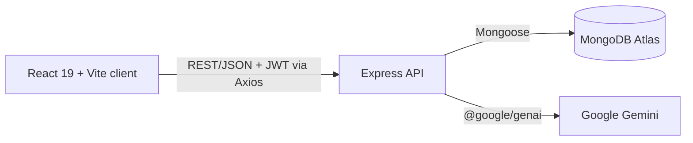
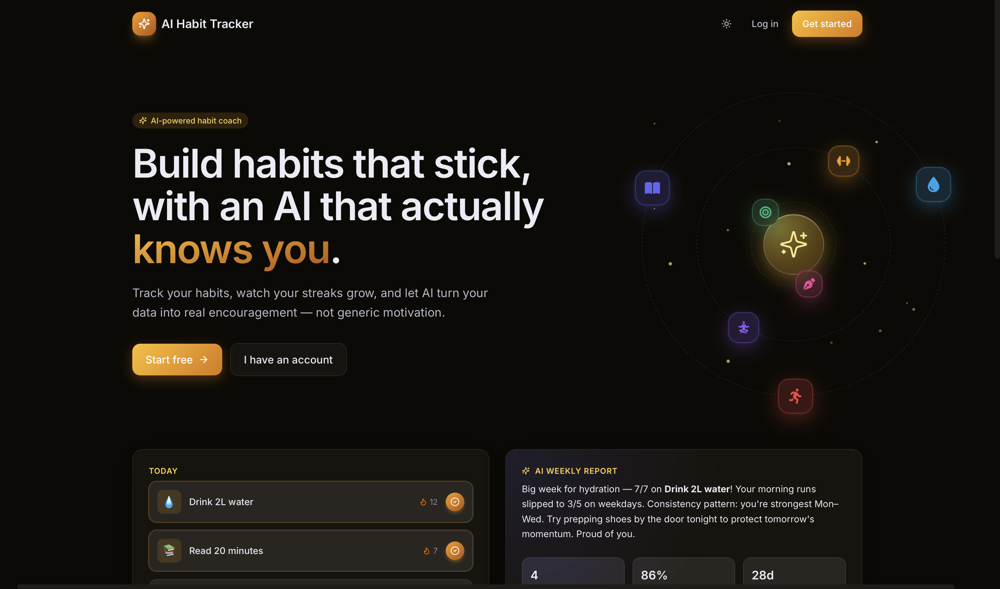
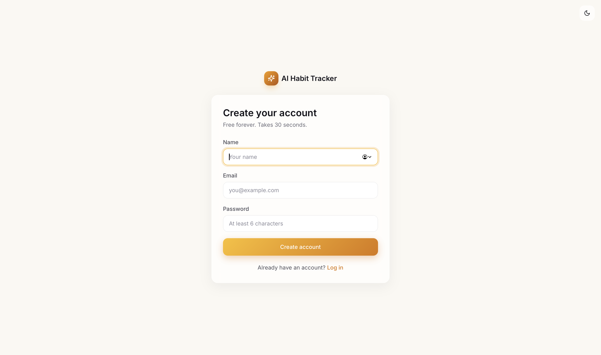
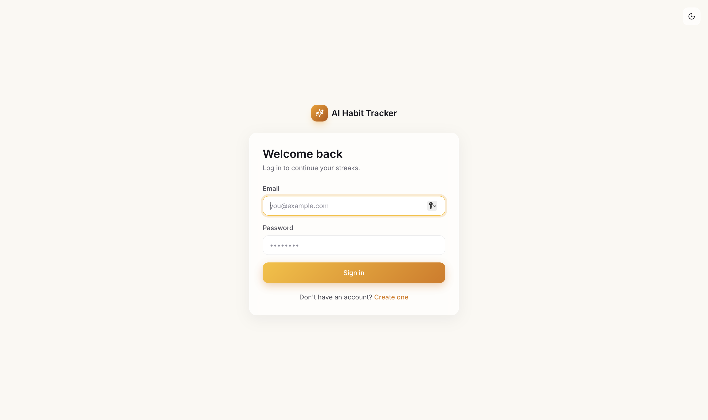
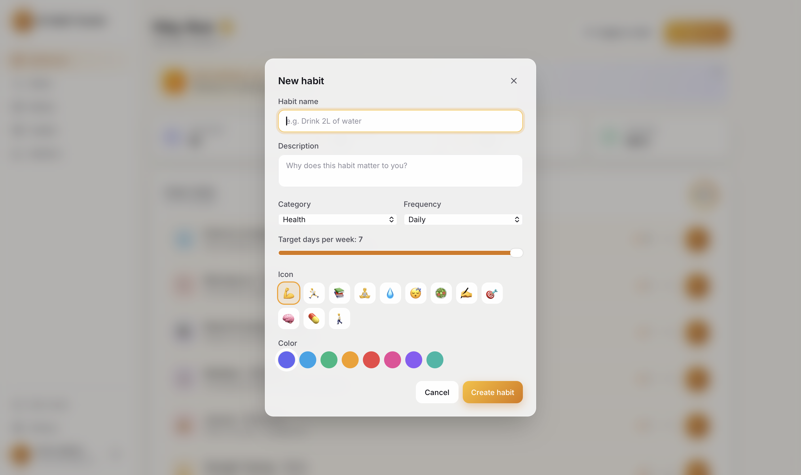
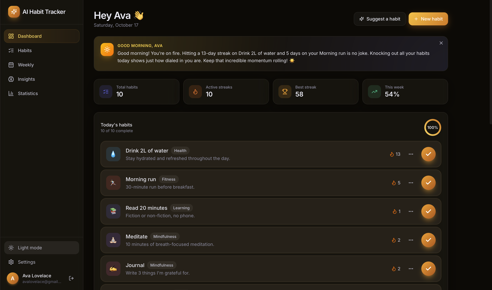
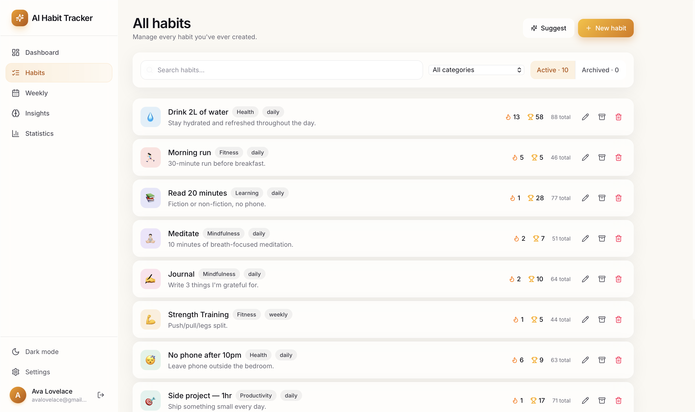
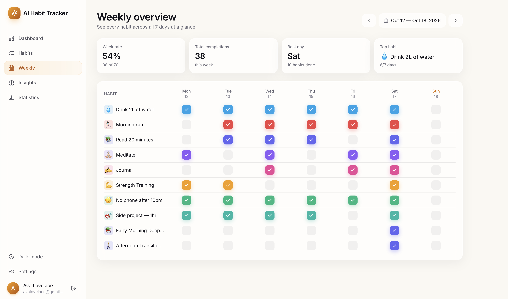
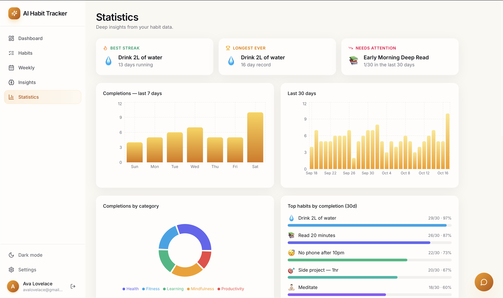
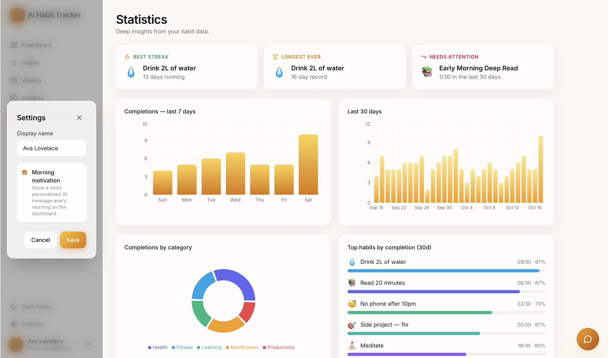

# AI Habit Tracker — Full Documentation

> The complete reference for AI Habit Tracker. For a quick overview, see the [main README](../README.md).


## Table of Contents

- [Overview](#overview)
- [Features](#features)
- [Tech Stack](#tech-stack)
- [Architecture](#architecture)
- [Getting Started](#getting-started)
- [Environment Variables](#environment-variables)
- [API Reference](#api-reference)
- [Database Schema](#database-schema)
- [Security & Reliability](#security--reliability)
- [Project Structure](#project-structure)
- [Screenshots](#screenshots)
- [Development Log](#development-log)
- [Background & Acknowledgments](#background--acknowledgments)
- [License](#license)

## Overview

AI Habit Tracker is a MERN-stack application for building and maintaining daily habits. Users check off habits, build streaks, and review their consistency through a 90-day heatmap, a weekly overview, and theme-aware charts. Five features powered by Google Gemini turn that data into a weekly report, habit suggestions, streak recovery plans, natural-language answers about the user's own data, and morning motivation.

The system has three parts. A React 19 and Vite client talks to an Express REST API over JSON, authenticated with JWTs. The API stores users, habits, completion logs, and AI output in MongoDB Atlas through Mongoose, and calls Gemini with context it builds from that data. A seed script creates a fully populated demo account so the app can be explored immediately.

## Features

### AI features

| Feature | What it does |
| --- | --- |
| **Weekly report** | Reviews the past 7 days of habit data and writes a personalized 120–180 word report. It generates automatically on the first Insights visit each week, is cached in local storage by the week's start date so revisiting doesn't spend API calls, and can be regenerated on demand. An expandable version also lives on the dashboard. |
| **Habit suggestion wizard** | A three-step modal asks about the user's goals, most productive time of day, and habits they struggle with. Gemini returns three suggestions as JSON, each with a "why this fits you" reason, and any can be added in one click. If the response can't be parsed, a default set is returned instead. |
| **Streak recovery coach** | A card appears when a streak of 7 or more days breaks. It generates a warm 3-day recovery plan tailored to that habit, using its current and longest streak. |
| **Habit data chat** | A floating chat bubble on the Statistics page. The backend builds a context payload from the user's active habits, their last 30 days of logs, and a per-weekday breakdown, so answers to questions like "Why do I keep failing my exercise habit?" are grounded in real numbers. Responses render as markdown. |
| **Morning motivation** | A short message that names the user's actual habits and current streaks. It is enabled per user in settings and generated at a higher temperature so daily messages feel varied. |

### Core features

- **Landing page:** glassmorphism design with a soft aurora background, an animated hero illustration of habit icons orbiting a glowing sun, preview cards, a four-feature grid, and a call-to-action
- **Light and dark mode:** a theme toggle on every page; the choice is saved in local storage and the system preference is respected on first visit
- **Authentication:** sign up with name, email, and password, with automatic login afterward; login shows validation and credential errors inline; the JWT is stored in local storage
- **Dashboard:** summary cards (total habits, active streaks, best streak, this week's completion rate), a today list with a circular progress ring, per-habit streak counts, confetti on each completion and a larger celebration when every habit is done, and a three-dot menu for edit, archive, and delete
- **Weekly grid and heatmap:** a grid of all habits across the current week with glowing squares in each habit's color, next to a GitHub-style 90-day heatmap that shifts from pale to deep amber with activity
- **New habit modal:** name, description, category (nine options), frequency, a target-days slider, an icon picker, and a color picker
- **Habit management:** search, category filter, and active or archived tabs with counts; each row shows current streak, longest streak, and 90-day completions; edit, archive, and delete actions. Archived habits keep their entire history but leave the daily list, which helps when moving between life phases
- **Weekly overview:** week navigation with a "today" shortcut, future weeks disabled, summary cards (week rate, total completions, best day, top habit), and the full weekly grid
- **Insights:** the AI weekly report, summary cards with a week-over-week delta pill, and charts for completions by day, this week versus last week, completions by category, habit performance (a glow at 100%), and an active streaks board. All charts adapt to the active theme
- **Statistics:** highlight cards (best streak, longest ever, needs attention), 7-day and 30-day completion charts, a category pie chart, a top-habits list ranked by 30-day completions, and a full habit list
- **Settings:** update the display name and toggle morning motivation
- **Demo data:** a seed script builds a demo user with 8 habits and about 500 logs over 90 days

## Tech Stack

| Layer | Technology |
| --- | --- |
| **Frontend** | React 19, Vite 8, Tailwind CSS v4 (theme tokens, glass utilities, dark mode via `@custom-variant`), React Router 6, Axios, Recharts, react-markdown, canvas-confetti, lucide-react, react-icons, date-fns, dnd-kit |
| **Backend** | Node.js, Express 4, JSON Web Tokens (`jsonwebtoken`), bcrypt.js, date-fns, dotenv, cors, nodemon (dev) |
| **Database** | MongoDB Atlas with Mongoose 8 |
| **AI** | Google Gemini 3.6 Flash via `@google/genai` |
| **Other** | ESLint, a custom-built heatmap component, Postman for API testing |

## Architecture



Requests flow through a clear stack: routes, the `protect` JWT middleware, controllers, then Mongoose models. Shared logic lives in `utils/`: `dateHelpers.js` handles date keys and streak math, and `aiService.js` wraps Gemini and holds the system prompts. The key design idea is that AI endpoints never ask the model to guess. Each one builds a structured context from the user's real MongoDB data, sends it with a purpose-tuned system prompt, and stores the result as an `AIInsight` record.

## Getting Started

### Prerequisites

- Node.js (LTS recommended) and npm
- A MongoDB Atlas cluster (or a local MongoDB instance)
- A Google Gemini API key from Google AI Studio (optional; without it the AI features return a fallback message)

### 1. Clone and install

```bash
git clone https://github.com/coderbri/ai-habit-tracker.git
cd ai-habit-tracker

cd backend
npm install

cd ../frontend
npm install
```

### 2. Configure

Each app ships with a committed `.env.example` that shows the variables it expects without exposing any secrets. Copy it to `.env` (which is gitignored) and fill in your own values, using the tables in [Environment Variables](#environment-variables):

```bash
cp backend/.env.example backend/.env
cp frontend/.env.example frontend/.env
```

Generate a secure `JWT_SECRET` with:

```bash
node -e "console.log(require('crypto').randomBytes(64).toString('hex'))"
```

### 3. Set up data

```bash
cd backend
npm run seed
```

The seed creates a demo user with 8 habits and roughly 500 completion logs over the last 90 days. The data comes from a deterministic generator, so every run produces the same result. It is safe to rerun: if the demo user already exists, their habits, logs, and AI insights are wiped and rebuilt from scratch.

### 4. Run the app

The backend and frontend run in separate terminals, and **both must be running**.

```bash
# Terminal 1 — backend
cd backend
npm run dev
```

```bash
# Terminal 2 — frontend
cd frontend
npm run dev
```

The API listens on `http://localhost:8000` and the client on `http://localhost:5173`. To confirm the backend is up, open `http://localhost:8000/api/health`; it should return `{"status":"ok","time":"..."}`.

Sign in with the demo account:

| Email | Password |
| --- | --- |
| `avalovelace@gmail.com` | `password123` |

### Troubleshooting

**"Login failed" right after seeding.** `npm run seed` is a standalone script: it connects to MongoDB, writes the data, and exits without starting Express, so a successful seed says nothing about whether the API is running. If the browser console shows the following, nothing is listening on port 8000:

```
Cross-Origin Request Blocked: ... (Reason: CORS request did not succeed). Status code: (null).
```

A `(null)` status means the request never got a response. A real CORS rejection returns an actual status code. Confirm by opening `http://localhost:8000/api/health`; if it fails to load, start the backend with `npm run dev`.

**Backend crashes on startup with `querySrv ENOTFOUND`.** DNS can't resolve the cluster hostname in `MONGO_URI`, so this is not a password or IP allowlist problem.

1. In MongoDB Atlas, check the cluster. Free-tier clusters are paused after a period of inactivity: click **Resume** and restart the backend. If the cluster was deleted, create a new one, update `MONGO_URI`, and run `npm run seed` again.
2. Test DNS with `nslookup -type=SRV _mongodb._tcp.<your-cluster-host>`. If it fails, try different DNS servers (`8.8.8.8` or `1.1.1.1`) or disable any VPN.
3. As a workaround, use Atlas's standard (non-SRV) `mongodb://` connection string.
4. Check `MONGO_URI` for typos, stray spaces, and URL-encode any special characters in the password.

After fixing it, save any file in `backend/` or type `rs` in the nodemon terminal to restart.

**Changed an environment variable and nothing happened.** Vite only reads `.env` at startup, so restart the frontend dev server after changing `frontend/.env`.

## Environment Variables

### Backend (`backend/.env`)

| Variable | Description | Example |
| --- | --- | --- |
| `MONGO_URI` | MongoDB connection string. **required** | `mongodb+srv://<user>:<password>@<cluster>.mongodb.net/<db>` |
| `JWT_SECRET` | Secret used to sign auth tokens. **required** | a 64-byte hex string |
| `JWT_EXPIRES_IN` | Token lifetime. Defaults to `30d` | `30d` |
| `GEMINI_API_KEY` | Enables the five AI features. Without it, AI routes return a fallback message | `<your-api-key>` |
| `GEMINI_MODEL` | Gemini model name. Defaults to `gemini-3.6-flash`; override if Google retires it | `gemini-3.6-flash` |
| `CLIENT_URL` | Comma-separated frontend origins allowed by CORS. `localhost` and `127.0.0.1` are always allowed | `https://my-app.vercel.app` |
| `PORT` | API port. Defaults to `8000` | `8000` |

### Frontend (`frontend/.env`)

| Variable | Description | Example |
| --- | --- | --- |
| `VITE_API_URL` | Base URL the Axios client sends requests to. Falls back to `http://localhost:8000/api` | `http://localhost:8000/api` |

If `MONGO_URI` is missing, the backend logs an error and exits on startup. If `GEMINI_API_KEY` is missing, the app runs normally and only the AI features degrade. Vite exposes only variables prefixed with `VITE_` to the client.

## API Reference

All routes live under `/api`. Every route except `GET /api/health`, `POST /api/auth/register`, and `POST /api/auth/login` requires an `Authorization: Bearer <token>` header, and all data is scoped to the authenticated user. For full request and response examples, see [API_TESTING.md](API_TESTING.md).

| Resource | Endpoints |
| --- | --- |
| **Health** | `GET /api/health` |
| **Auth** | `POST /api/auth/register` · `POST /api/auth/login` · `GET /api/auth/me` · `PUT /api/auth/profile` |
| **Habits** | `GET /api/habits` · `POST /api/habits` · `PUT /api/habits/:id` · `DELETE /api/habits/:id` · `PUT /api/habits/:id/archive` · `PUT /api/habits/reorder` |
| **Logs** | `POST /api/logs` · `DELETE /api/logs` · `GET /api/logs/today` · `GET /api/logs/range` · `GET /api/logs/heatmap` · `GET /api/logs/stats` · `GET /api/logs/stats/:habitId` |
| **AI** | `POST /api/ai/weekly-report` · `POST /api/ai/suggest-habits` · `POST /api/ai/recovery-plan` · `POST /api/ai/chat` · `GET /api/ai/morning` |

Notes on specific routes:

- `GET /api/habits` returns active habits by default; add `?includeArchived=true` to include archived ones.
- `PUT /api/habits/:id/archive` is a toggle: calling it on an archived habit unarchives it.
- `DELETE /api/habits/:id` also deletes that habit's completion logs.
- `POST /api/logs` and `DELETE /api/logs` take `{ "habitId": "...", "date": "YYYY-MM-DD" }`; `date` defaults to today. Marking is idempotent.
- `GET /api/logs/range` takes `?start=YYYY-MM-DD&end=YYYY-MM-DD`.

Errors use one consistent shape across the whole API:

```json
{
  "message": "Habit not found"
}
```

Status codes: `400` for invalid input, `401` for missing or invalid credentials and tokens, `404` for resources or routes that don't exist (the message includes the attempted route), and `500` for server errors.

## Database Schema

Data lives in MongoDB Atlas, modeled with Mongoose. Habits, logs, and AI insights each carry a `userId` reference, and every query filters by the authenticated user. Deleting a habit cascades to its logs in the controller.

| Collection | Purpose and key fields |
| --- | --- |
| `users` | Accounts. `name`, `email` (unique, lowercased), `password` (bcrypt hash), `avatar`, `morningMotivation` |
| `habits` | Habit definitions. `userId`, `name`, `description`, `category` (9 options), `frequency` (`daily` or `weekly`), `targetDays` (1–7), `color`, `icon`, `isArchived` (soft-delete flag), `order` (manual ordering) |
| `habitlogs` | One document per habit per completed day. `userId`, `habitId`, `completedDate` (`"YYYY-MM-DD"` string), `notes`. A unique compound index on `userId` + `habitId` + `completedDate` prevents duplicates |
| `aiinsights` | Persisted AI output. `userId`, `type` (`weekly`, `suggestion`, `recovery`, `chat`, or `morning`), `content`, `meta` (flexible context such as the question asked), `generatedAt` |

All collections include Mongoose timestamps (`createdAt`, `updatedAt`).

## Security & Reliability

- **Passwords are hashed and never returned.** A pre-save hook hashes passwords with bcrypt only when they are new or changed, and a `toJSON` override strips the hash from every serialized user, so a forgotten filter can't leak it.
- **JWT authentication on every private route.** The `protect` middleware verifies the token and confirms the user still exists before attaching them to the request. Token lifetime is configurable.
- **Strict per-user data isolation.** Reads, updates, and deletes always match on both the document id and the authenticated `userId`, so another user's document returns a 404 instead of data.
- **Duplicate-proof, retry-safe completions.** A unique compound index and an upsert with `$setOnInsert` make marking a habit complete idempotent.
- **Timezone-safe dates.** Completions are stored as `YYYY-MM-DD` strings rather than timestamps, so streak math and range queries don't shift with the user's timezone.
- **Restricted CORS and bounded requests.** Allowed origins come from `CLIENT_URL` plus localhost for development, methods and headers are whitelisted, and JSON bodies are capped at 1 MB.
- **AI fails gracefully.** The Gemini client initializes lazily and only when a key exists, so a missing key never crashes startup. Failed or disabled calls return a readable fallback, and malformed suggestion JSON falls back to a default set.
- **Fail-fast database startup.** The server only starts listening after MongoDB connects, and exits with a clear error if it can't.
- **Consistent error handling.** A not-found handler and a central error handler return the same `{ "message": ... }` shape everywhere. On the client, a response interceptor clears the session and redirects to login on a `401`, skipping the landing and auth pages to avoid redirect loops.

## Project Structure

```
ai-habit-tracker/
├── backend/               # Node.js + Express API
│   ├── config/            # db.js — MongoDB connection
│   ├── controllers/       # auth, habit, log, and AI controllers
│   ├── middleware/        # auth.js (JWT protect), errorHandler.js
│   ├── models/            # User, Habit, HabitLog, AIInsight
│   ├── routes/            # auth, habits, logs, ai
│   ├── scripts/           # seed.js — demo user, habits, and logs
│   ├── utils/             # dateHelpers.js (streak math), aiService.js (Gemini wrapper)
│   ├── .env.example       # variable template (no secrets)
│   └── server.js
├── frontend/              # React + Vite client
│   ├── src/
│   │   ├── api/           # axios.js — JWT auto-attach, 401 redirect
│   │   ├── assets/
│   │   ├── components/
│   │   ├── context/       # AuthContext, ThemeContext
│   │   ├── pages/
│   │   └── utils/
│   └── .env.example       # variable template (no secrets)
├── docs/
│   ├── API_TESTING.md
│   ├── DOCUMENTATION.md
│   ├── NOTES.md
│   └── screenshots/
├── CHANGELOG.md
├── LICENSE
└── README.md
```

## Screenshots

### Landing and sign in

| Light mode | Dark mode |
| --- | --- |
|  |  |

| Sign up | Log in |
| --- | --- |
|  |  |

### Dashboard


| New habit modal | AI suggestion wizard |
| --- | --- |
|  |  |




### Habits and weekly overview

| Habit management | Weekly overview |
| --- | --- |
|  |  |

### Insights and statistics





### Settings



## Development Log

The project was built in 11 versioned releases. See [CHANGELOG.md](../CHANGELOG.md) for what shipped in each version, and [NOTES.md](NOTES.md) for the commands, logic breakdowns, and lessons learned along the way.

| Version | Milestone |
| --- | --- |
| v0.1.0 | Project structure: frontend boilerplate cloned, backend initialized with dependencies |
| v0.2.0 | Environment variables, MongoDB Atlas, Express server, health check, and error handling |
| v0.3.0 | User model and JWT authentication |
| v0.4.0 | Habits CRUD with archive and cascading delete |
| v0.5.0 | Habit log API with streak and date helpers |
| v0.6.0 | Five Gemini-powered AI endpoints and the `AIInsight` model |
| v0.6.1 | AI endpoint testing and Gemini model update after the 2.5 Flash retirement |
| v0.6.2 | Weekly report persistence and completion-count fixes |
| v0.7.0 | Frontend connected to the live API, mock data removed |
| v0.8.0 | End-to-end testing and environment-based API URL |
| v0.9.0 | Seed script and fully populated demo account |

## Background & Acknowledgments

This project follows the tutorial [Build a Full-Stack AI-Powered Habit Tracker App | MERN, React, Node.js, MongoDB, Express](https://youtu.be/PO-UZsQnkNU) by Time to Program. 

The tutorial supplied the frontend boilerplate and the overall design; I built the backend by following along, connected the two, and then debugged, tested, and documented the system. Where my version departs from the tutorial (for example, `findOneAndDelete` for unmarking completions, and Gemini 3.6 Flash after 2.5 Flash was retired for new users), the reasoning is recorded in [NOTES.md](NOTES.md).

## License

Released under the [MIT License](../LICENSE).